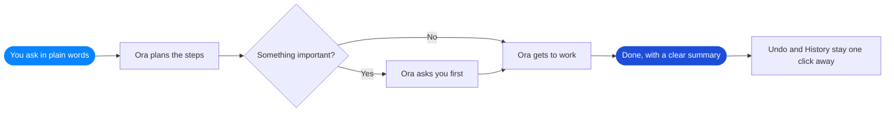
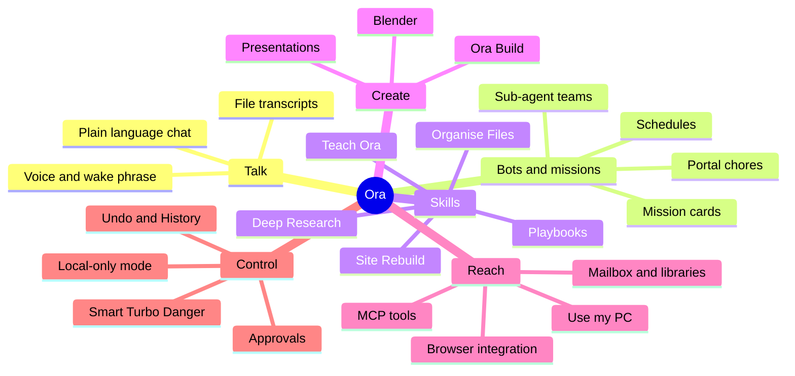
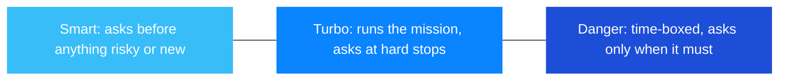
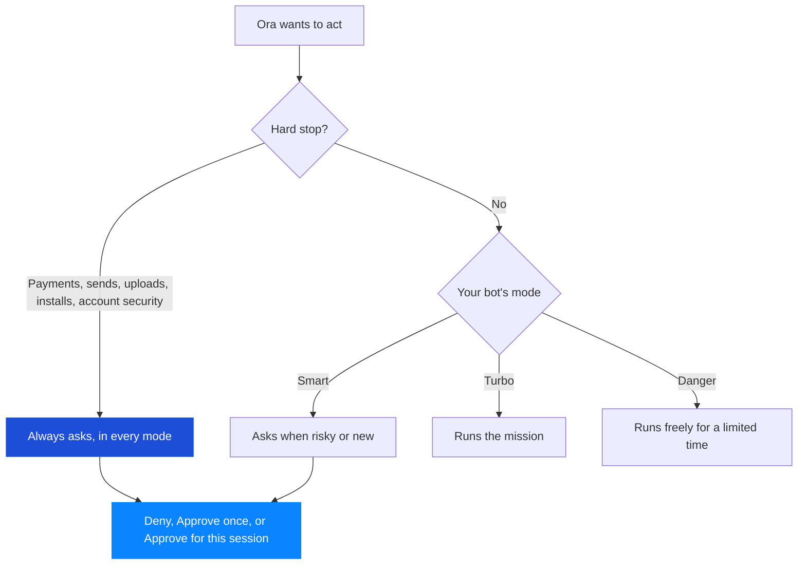
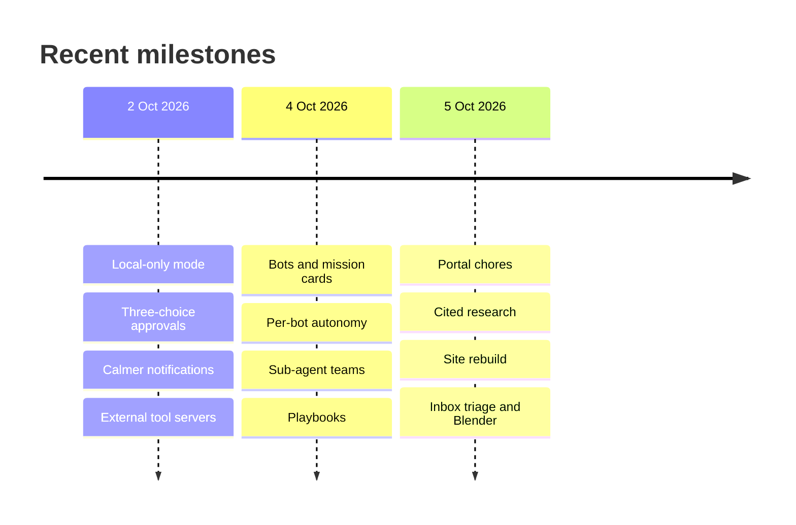

 

*A desktop AI companion for Windows that opens, browses, writes and organizes alongside you, always with your say-so.*

---

> **A showcase repository.** It contains no source code, only a tour of what Ora is and the experience it creates.
>
> 🔬 **Ora is a free research project**, shared with a small circle of early testers while it grows. Follow along at [ora.zenix.sg](https://ora.zenix.sg). See the [release highlights](VERSIONS.md) for how it has grown.

## The idea

Imagine a capable, friendly assistant sitting beside you at your computer. Tell it what you'd like in everyday words, and it gets to work: opening apps, browsing the web, drafting files, tidying folders, writing code and handling the little chores that eat up your day.

Ora is built around one gentle promise: **you stay in charge.** It asks before it acts on anything that matters, it shows its plan before it moves a single file, and the moment you reach for your mouse or keyboard, it steps aside.

## How a request becomes done

## The Ora map

Everything Ora does lives in one of a handful of neighborhoods, and they all share the same approval and privacy rules.

## Pick your pace

Every bot has its own mode, so you can be cautious in one place and bold in another.

---

# The complete tour

Every feature below ships in Ora today, grouped by what you are trying to do.

## 1. Talking to Ora

| Feature | What it feels like |
|---|---|
| **Plain-language chat** | Ask a question, follow up, change your mind halfway. Ora keeps the thread. |
| **Attach a document** | Drop a file into a message and Ora reads a bounded, redacted slice of it, only when you press send. |
| **Drafts that wait for you** | No model connected yet? Your message is saved and sends itself the moment you finish setup. |
| **Your choice of brain** | Answer on your own PC, bring your own key for a cloud model, or decide later. Switch any time from the model picker. |
| **Command palette** | Press Ctrl+K to reach anything in a few keystrokes. |
| **Keyboard-first** | Shortcuts for new chats, sidebar, inspector and full workspace tab control (open, close, reopen, jump to tab 1 to 9). Layout-aware, so they work on AZERTY, QWERTZ and Dvorak too. |
| **Stop, Undo, History** | A Stop button beside the message box, an Undo in the chat header that puts files back, and a History rail listing what you asked, what changed and how it ended. |
| **What can Ora do?** | Press ? anywhere for a plain-language capability guide built right into the app. |
| **Get help** | A life-ring button opens the guide, troubleshooting and a previewed support summary you can copy. |

## 2. Bots and missions

A **bot** is a chat with a job. It has a name, its own settings and its own memory of what you have allowed it.

| Feature | What it feels like |
|---|---|
| **New bot** | One button, and a chat becomes a worker. |
| **Mission card** | A card pinned to the top of the chat spells out the goal, the "done when" test, the places it may touch, a "never" list, when it should pause and ask, the schedule and the budget. |
| **Schedules** | Run once, every few hours, daily or weekly, or press Run now. |
| **Always-on task bar** | Shows what is running, what is waiting on you, and offers pause, resume and stop for every task, plus Stop all. |
| **Waiting for you** | A stuck bot parks and asks its question in its own chat instead of guessing. |
| **Plans from specs and photos** | Hand over a requirements document and a whiteboard photo. Ora proposes a milestone plan, you approve it, and it works through one proven step at a time with a progress tracker on the card. |
| **Portal chores with receipts** | Download assignment files, check your work against the requirements, and upload with your say-so. Every attempt leaves a receipt, and a job counts as done only when the portal confirms it. |
| **Honest about gaps** | If your PC slept or Ora was closed, it tells you what happened, can catch up eligible chores with one clearly labeled late run, and never pretends it was on time. |
| **Coding-agent bots** | A bot's chat can be backed by a command-line coding agent on your PC, working in its own workspace folder with every change shown as a question for you. |
| **Per-bot notifications** | Silent, a once-a-day Digest, or Ping for the events you pick, with quiet hours that still let urgent questions through. |
| **History per bot** | Filter History by bot and replay to the exact event. |

## 3. Sub-agent teams

| Feature | What it feels like |
|---|---|
| **Team of helpers** | A bot on a big job can create sub-bots for pieces of the work. |
| **Sub-agents panel** | See every member with its role, name and mode, and open any member's own chat. |
| **Safe by inheritance** | A sub-bot never has more power than its lead: narrower scope, stricter autonomy, bounded depth and a shared budget. |
| **Typed team notes** | Members swap short notes such as finished, blocked, needs review or question for you, rendered as tidy two-line entries. |
| **Questions for you** | A teammate can ask you directly, and urgent questions reach you even during quiet hours. |
| **Team chat in Build** | The team panel shows bounded task and handoff updates, and what you type steers the whole team. |

## 4. Autonomy and approvals

| Feature | What it feels like |
|---|---|
| **Smart, Turbo and Danger** | Three autonomy modes, set per bot. Danger is time-boxed (4 hours by default, 24 at most) with a live countdown, then steps itself back down. |
| **Always-ask hard stops** | Spending money, running commands, uploads, installs, sending messages, account-security changes and reading password files ask every time, whatever the mode. |
| **Three-choice approval cards** | Deny, Approve once, or Approve for this session. Focus starts on Deny, and a clear "Why" line says what Ora intends to touch. |
| **Session approvals you can revoke** | Active session approvals are listed in the task bar with a Revoke button. |
| **Standing permissions** | Record a rule (Always ask, Never ask, Ask first time only) for an exact site, recipient, app or folder, and remove it any time. |
| **Thoughtful deletes** | Ora judges each delete: safe ones are recorded for Undo, risky ones ask, and protected places such as system folders are refused outright. Your own words in the current chat can count as confirmation. |
| **Remembered sites** | Per bot, you decide which sites it may act on and sign in to, and can revoke them in one click. |
| **Your hands always win** | Touch the mouse or keyboard while Ora drives the screen and it pauses instantly. |

## 5. Skills and everyday chores

| Feature | What it feels like |
|---|---|
| **Organise Files** | Tidy a folder by file type, by month, by renaming pattern, or by grouping likely duplicates. You see the plan first, nothing is deleted or overwritten, and Undo puts every file back. |
| **Deep Research** | Ora reads a limited set of pages and writes a report where every claim carries a citation checked against a page it opened. Conflicting numbers are listed, not quietly merged. |
| **Site Rebuild** | Point Ora at a captured or public page and it rebuilds the layout, text and design as a small, editable local project. |
| **Playbooks** | After Ora does a task the same way twice in a place, it remembers the steps by meaning and replays them faster next time. Review or forget them any time in Settings. |
| **Record a demonstration** | Show Ora a routine once (Ctrl+Alt+R), review the steps, and save it as a reusable recipe. |
| **Teach Ora recipes** | Author your own app-specific runbooks that follow the same approval rules. |
| **Learned workflows** | Ora can propose automations from sessions that worked, and you review, enable and trust each one yourself. |
| **Skill import and export** | Share skills as files, and review any imported one before it does anything. |

## 6. Ora Build

A built-in coding companion that works in a folder you choose.

| Feature | What it feels like |
|---|---|
| **Build sessions** | Inspect a project, propose changes, edit files, run workspace commands and see the diff. |
| **Plan, Ask, Accept Edits** | Pick how much Build does on its own, and cycle modes with Ctrl+Alt+M. New sessions start in Ask. |
| **Reviewable and reversible** | Read every proposed change, and Undo restores everything a turn created, changed or renamed. |
| **Project understanding** | A local project map and prior context that you can refresh or clear. |
| **Helper bots** | Optional team work in Build, with the review steps intact. |
| **Model choice** | Pick the model for Build from the names available on your PC. |
| **GitHub pull requests** | An optional plugin that prepares a draft pull request and shows the repository, branch, title and description for your approval first. |
| **The Ora command line** | Run Build or chat from a terminal, with one-shot prompts, session resume, JSON output, a readiness check and steady exit codes. It works while the desktop app is open. |

## 7. Presentations

| Feature | What it feels like |
|---|---|
| **Brief to deck** | Describe what you need and Ora creates a slide outline and an editable preview. |
| **Export** | Send finished decks out as PDF or PPTX from a contained workspace. |

## 8. Browser, PC and screen control

| Feature | What it feels like |
|---|---|
| **Use my PC** | Open, click, type and scroll through Windows apps and the browser, with pause and stop controls. |
| **Browser integration** | Ora reads and types in the tabs you place in an Ora workspace, using your real browser. |
| **Background input** | Interact through Windows accessibility controls without moving your pointer or stealing focus. |
| **UI skeleton** | Gives the planner a compact outline of visible controls. |
| **Pixel regions** | Spot likely controls in apps without an accessibility tree, such as canvases and remote desktops. |
| **Vision Bridge** | Captions a redacted screen image with an on-device vision model. |
| **Projects and workspace tabs** | Up to 24 project tabs, each with its own chats, Build sessions and memory, plus recently closed tabs you can reopen. |

Plugins in **Settings, Tools, Get more** are optional and switch on and off without losing settings.

## 9. Connectors and creative apps

| Feature | What it feels like |
|---|---|
| **Inbox triage** | A digest of your latest mail: urgent today, needs a reply, just informational, with card numbers, passwords and codes masked. |
| **Draft-first mail** | Replies land in your Drafts folder for you to send. Sending, if you allow it, still asks every time and names the exact recipient. |
| **Photo and video libraries** | Point Ora at a folder and bots can find things in it. Files stay where they are. |
| **Blender** | After a one-click add-on, Ora builds scenes, adds materials, lights, renders and exports inside the project folder you pick, with every edit undoable. |

## 10. Voice

| Feature | What it feels like |
|---|---|
| **Push-to-talk** | Tap the microphone and speak. Capture and recognition run on your PC. |
| **Wake phrase** | Turn on Voice mode and say "Hey Ora" for hands-free requests and spoken replies. |
| **Always-visible listening** | A tray indicator shows whenever the mic is live, with a Stop action. |
| **Transcribe a file** | Turn a recording into plain text, SRT subtitles or VTT captions, entirely on your PC. |

## 11. Automations

| Feature | What it feels like |
|---|---|
| **Schedules and workflows** | Save instructions on a timer, or a sequence you start yourself. |
| **Pause all runs** | One switch halts every recurring job, and one switch resumes them. |
| **Per-run history** | See each run and how it ended. |

## 12. Connecting other tools (MCP)

| Feature | What it feels like |
|---|---|
| **External MCP servers** | Connect helper tools you configure, local or over HTTPS, so Chat and Ora Build can use them. Every server and tool starts off, and every call asks. |
| **Resources and prompts** | Browse what a server shares before anything is used. |
| **Ora as an MCP server** | Expose Ora's own skills to other apps on your PC, off until you enable it, with a token you can reset any time. |

## 13. Privacy, settings and peace of mind

| Feature | What it feels like |
|---|---|
| **Local-only mode** | One switch keeps content on your PC by blocking cloud routes. |
| **Consent you can review** | Screen content, voice transcripts and other sharing each have their own revocable choice. |
| **What left this PC** | A live list of every destination Ora contacted, newest first. |
| **Delete all my Ora data** | One button erases everything Ora stored, with a Windows confirmation. |
| **Settings search** | Type a phrase and jump to the right setting. |
| **Appearance** | Dark theme, text scaling up to Extra large, and tab placement. |
| **Diagnostics bundle** | Prepare a redacted bundle for support and save it wherever you like. |
| **Safe mode** | Start with optional plugins off to get back to a clean slate. |
| **Update check** | See your version and whether a newer one is available. |

---

## Release highlights

Ora keeps growing. Newest first (the full story is in [VERSIONS.md](VERSIONS.md)).

<b>5 October 2026: work that finishes itself</b>

- Portal chores that fetch, check, upload and leave a receipt.
- Research reports with citations verified against real pages.
- Websites rebuilt as editable local projects.
- Inbox digests, draft-first replies and a Blender bridge.
- Three-choice approvals with revocable session grants.

<b>4 October 2026: chats become workers</b>

- Bots, mission cards, schedules and the always-on task bar.
- Smart, Turbo and time-boxed Danger modes per bot.
- Standing permissions, remembered sites and notification modes.
- Sub-agent teams with typed messages and shared budgets.
- Playbooks that learn a routine and repair themselves when a site changes.

<b>2 October 2026: a calmer, clearer Ora</b>

- Local-only mode now covers every cloud route.
- One native confirmation for sensitive privacy choices.
- Voice transcripts stay on your PC unless you say otherwise.
- Pause and resume for automations, with per-run history.
- Friendlier first-run setup, with a skip button that keeps everything safe.
- Faster opening of long chats and history.

---

**Ora** · crafted by [Zenix Developers](https://github.com/Zenix-Developers) · [zenix.sg](https://zenix.sg)

*The source code is private. Interested in a closer look? Get in touch.*

