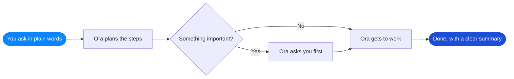
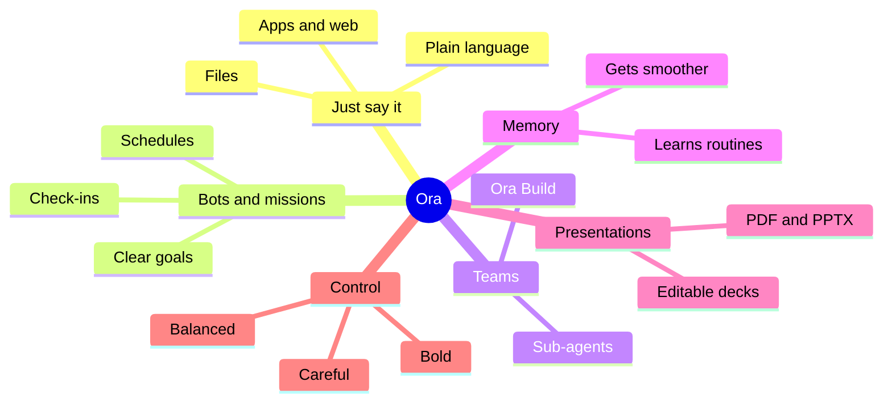
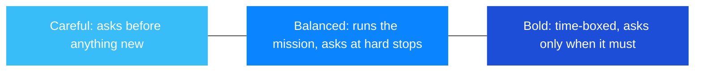

 

*A desktop AI companion for Windows that opens, browses, writes and organizes alongside you, always with your say-so.*

---

> **A showcase repository.** It contains no source code, only a tour of what Ora is and the experience it creates.

## The idea

Imagine a capable, friendly assistant sitting beside you at your computer. Tell it what you'd like in everyday words, and it gets to work: opening apps, browsing the web, drafting files and handling the little chores that eat up your day.

Ora is built around one gentle promise: **you stay in charge.** It asks before it acts on anything that matters, and the moment you reach for your mouse or keyboard, it steps aside.

## How a request becomes done

## What Ora brings to your day

| | Feature | What it feels like |
|---|---|---|
| 🗣️ | **Just say it** | Type a request in plain language and watch it come together |
| 🎯 | **Missions** | Pin a clear goal to a bot, with when it's done, where it may go and when it checks in |
| 🤝 | **Sub-agent teams** | Share bigger jobs across a group of specialist helpers |
| 🛠️ | **Ora Build** | A built-in coding companion that works in a tidy workspace of its own |
| 🧠 | **Playbooks** | Ora remembers how a routine task is done, so next time is smoother |
| 🎞️ | **Presentations** | Turn a brief into an editable deck, exported as PDF or PPTX |
| 🛡️ | **Calm approvals** | Choose careful, balanced or bold, with sensible limits that keep you in control |
| 🖱️ | **Your hands win** | Touch the mouse or keyboard and Ora pauses instantly |

## Pick your pace

---

**Ora** · crafted by [Zenix Developers](https://github.com/Zenix-Developers)

*The source code is private. Interested in a closer look? Get in touch.*

