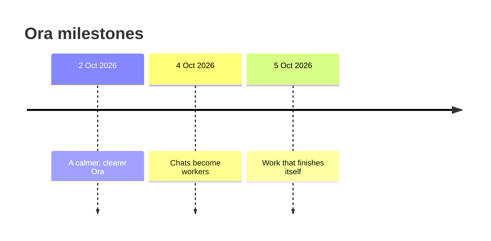

# Ora release highlights

A look at how Ora has grown, newest first. Ora is shared with a private beta group, and milestones are tracked by date.

## 5 October 2026: work that finishes itself

- **Portal chores with a paper trail.** Bots fetch assignment files, check them against the requirements, ask once before uploading and leave a receipt for every attempt.
- **Research you can check.** Reports where every claim carries a citation verified against a page Ora actually opened.
- **Websites into projects.** Ora rebuilds a captured page as a small, editable local project.
- **Your inbox, summarized.** A digest of what is urgent, what needs a reply and what is informational, with replies saved as drafts.
- **Blender, natively.** Build scenes, add materials, render and export inside a project folder you pick.
- **Three-choice approvals.** Deny, Approve once, or Approve for this session, with revocable session grants in the task bar.
- **Undo, widened.** Folder tidy-ups, research and site rebuild outputs and coding-agent edits all come back with one click.

## 4 October 2026: chats become workers

- **Bots and mission cards.** A chat can carry a clear goal, a "done when" test, allowed places, a schedule and a budget.
- **Always-on task bar.** See what is running, what needs you, and stop everything with one click.
- **Per-bot autonomy.** Smart, Turbo, and a time-boxed Danger mode with a live countdown.
- **Standing permissions and remembered sites** you can add and revoke at any time.
- **Notification modes.** Silent, a daily Digest, or Ping for the events you choose.
- **Sub-agent teams.** Helpers with narrower scope, typed messages and a shared budget.
- **Specs and photos in, milestone plans out.** Approve the plan, then watch each milestone get proven.
- **Honest catch-up.** Missed schedules are recorded, and eligible chores can run once, clearly labeled as late.
- **Playbooks.** Ora learns routines after two matching successes and repairs them when a site changes.
- **Coding-agent bots.** A command-line coding agent on your PC can power a bot, with every action approved in its chat.

## 2 October 2026: a calmer, clearer Ora

- **Local-only mode** now covers every cloud route, including model requests, screenshots, OCR and Build.
- **One clear confirmation** for sensitive privacy choices, listing exactly what is requested.
- **Voice stays local.** Transcripts remain on your PC unless you separately allow sharing.
- **Quieter notifications** that keep task text off the lock screen.
- **Automations** gained pause and resume, per-run history and tidy recovery after a restart.
- **Smarter first run.** Clearer setup, a Skip setup button, and safe defaults.
- **Diagnostics bundle** you can review and save yourself.
- **Safe mode** for a clean start.
- **Faster** long chats, History and search.
- **External MCP servers** and a resettable MCP server token for connecting helper tools.
- **Ora command line** that works alongside the open desktop app, with stable exit codes.
